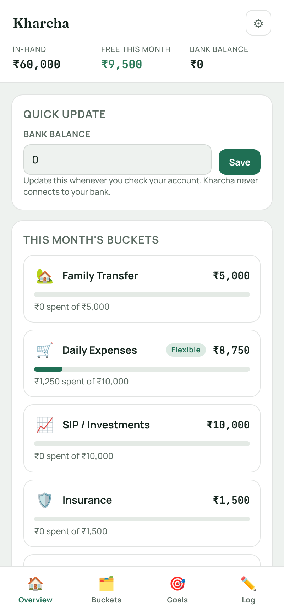
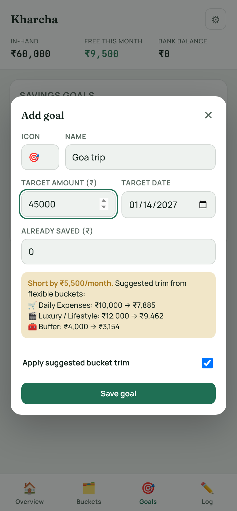

# Kharcha

A monthly budgeting app built around how most salaried people in India actually split their pay: a fixed transfer home, an SIP, insurance, an emergency fund, and whatever's left for living.

**[Open the live demo](https://AnshGupta6378.github.io/Kharcha/)** (works best on a phone)

  
  &nbsp;&nbsp;
  

## Why I built it

Every budgeting app I tried wanted to track every rupee by category. I don't think in categories, I think in buckets: this much goes home, this much goes to SIP, this much I can spend. I wanted to see what's left in each bucket this month, and when I add a new goal (a trip, a phone), to be told plainly what I'd have to give up to afford it.

## What it does

- **Buckets.** Set a monthly allocation for each one and see what's left as you spend. Bars turn amber at 80% and red when you go over.
- **Fixed vs flexible.** Mark buckets like SIP, insurance and emergency fund as fixed. Only flexible buckets are touched when money needs to move.
- **Goal planner.** Add a savings goal with a target and a date. Kharcha works out the monthly amount needed, and if it doesn't fit in what's free, it proposes trims across your flexible buckets, in proportion to their size, never cutting any bucket below 40% of its allocation. One tap applies the plan.
- **Auto-categorisation.** Type "Swiggy dinner" or "Blinkit groceries" and it suggests the right bucket from keywords you control.
- **Private by default.** Everything stays in your browser's local storage. No sign-up, no bank access, no server.

## How it's built

One HTML file, plain JavaScript, no build step. I designed it and built it with Claude. It started as a Claude artifact with a hosted database and AI suggestions; this version swaps in a small local-storage adapter so it runs anywhere, including GitHub Pages. The demo starts with sample numbers, so edit them in Settings and the Buckets tab to make it yours.

## Run it

Open `index.html` in a browser. That's it.
